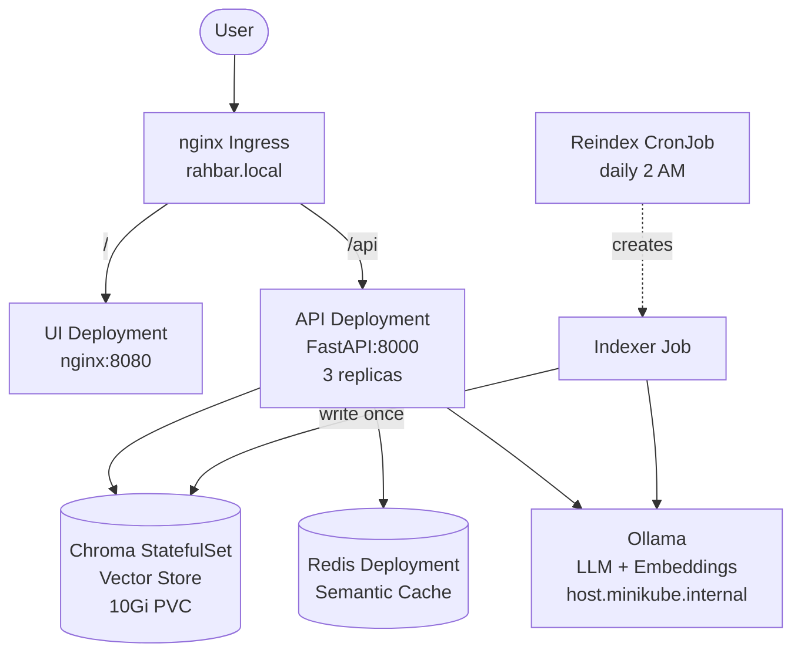

# RAHBAR — Grounded RAG on Kubernetes


RAHBAR is a Retrieval-Augmented Generation (RAG) system that answers questions about FAST-NUCES university policies. It ingests a curated document corpus (PDFs, HTML, Markdown), extracts and chunks the text with structure-aware splitting, embeds the chunks using a local embedding model (Ollama), stores them in a Chroma vector database, and serves a FastAPI endpoint that retrieves relevant passages and generates grounded answers via an LLM. The entire system runs on Kubernetes (minikube) with proper separation of concerns: an indexer Job writes the index, the API reads it, and a chat UI provides the user interface.

## Architecture



**Key invariant:** The Indexer Job is the only writer to Chroma. The API never indexes on startup — with 3 replicas, that would create 3 racing writers on one PVC.

## Prerequisites

- Docker Desktop with Kubernetes enabled, or minikube (`minikube start --driver=docker`)
- `kubectl` and `kustomize` (bundled with recent kubectl)
- Ollama installed and running: `OLLAMA_HOST=0.0.0.0 ollama serve`
- Python 3.12+ with pip
- GNU Make (via Git Bash, WSL2, or native)

## Quick Start (Clean Clone to Answered Question)

```bash
# 1. Clone and enter the repo
git clone https://github.com/WrittenByAli/Rahbar.git
cd Rahbar

# 2. Start minikube
minikube start --driver=docker
minikube addons enable ingress

# 3. Build and load images into minikube
make images

# 4. Create the namespace and apply manifests
kubectl apply -k k8s/overlays/dev/

# 5. Create the secret (never committed to git)
make secret KEY=your-api-key-here

# 6. Wait for pods to be ready
kubectl wait --for=condition=available deployment/api -n rahbar --timeout=120s

# 7. Run the indexer (dummy mode for Week 1, real mode for Week 2)
kubectl create job --from=cronjob/reindex reindex-now -n rahbar

# 8. Start minikube tunnel for Ingress access
minikube tunnel

# 9. Ask a question
curl -s http://rahbar.local/api/ask -H "Content-Type: application/json" \
  -d '{"question": "What is the attendance requirement?"}' | python -m json.tool

# 10. Open the UI
# Navigate to http://rahbar.local in your browser
```

## kubectl Apply Order

Apply resources in this order for clean first-time deployment:

```bash
kubectl apply -f k8s/base/namespace.yaml
kubectl apply -f k8s/base/configmap.yaml
kubectl apply -f k8s/base/chroma-statefulset.yaml
kubectl apply -f k8s/base/chroma-service.yaml
kubectl apply -f k8s/base/redis-deployment.yaml
kubectl apply -f k8s/base/redis-service.yaml
kubectl apply -f k8s/base/api-deployment.yaml
kubectl apply -f k8s/base/api-service.yaml
kubectl apply -f k8s/base/ui-deployment.yaml
kubectl apply -f k8s/base/ui-service.yaml
kubectl apply -f k8s/base/ingress.yaml
kubectl apply -f k8s/base/hpa.yaml
kubectl apply -f k8s/base/networkpolicy.yaml
kubectl apply -f k8s/base/indexer-job.yaml
kubectl apply -f k8s/base/indexer-cronjob.yaml
```

Or use Kustomize (recommended):

```bash
kubectl apply -k k8s/overlays/dev/   # stub mode
kubectl apply -k k8s/overlays/prod/  # real RAG mode
```

## API Endpoints

| Method | Path | Description |
|--------|------|-------------|
| POST | `/api/ask` | Ask a question. Body: `{"question": "..."}`. Returns `AskResponse` with answer, citations, retrieved passages. |
| GET | `/healthz` | Liveness probe. Returns 200 if the process is alive. Never touches dependencies. |
| GET | `/readyz` | Readiness probe. Checks Chroma (collection exists, non-empty, embed_model pin), Redis connectivity. Returns 503 on failure. |
| GET | `/metrics` | Prometheus metrics: `rahbar_requests_total`, `rahbar_latency_seconds`. |

## Running the Indexer

The indexer runs as a Kubernetes Job and is the only component that writes to Chroma.

```bash
# Dummy mode (Week 1, no model needed)
kubectl create job indexer-dummy --from=cronjob/reindex -n rahbar -- python -m pipeline.run --dummy

# Real pipeline (Week 2, requires Ollama with nomic-embed-text)
kubectl create job indexer-real --from=cronjob/reindex -n rahbar

# Check indexer logs
kubectl logs job/indexer-real -n rahbar -f

# The CronJob runs automatically at 2 AM daily
kubectl get cronjob reindex -n rahbar
```

## Running Tests

```bash
# Install dependencies
make install

# Run all tests (no cluster, no model, no network)
make test

# Run evaluation against a live cluster
make eval
```

## Project Structure

```
rahbar-starter/
├── api/                    # FastAPI service (Deployment, 3 replicas)
│   ├── app/
│   │   ├── main.py         # App entry, lifespan, middleware
│   │   ├── config.py       # Settings from env vars
│   │   ├── schemas.py      # Pydantic models (AskRequest, AskResponse, etc.)
│   │   ├── routes/         # healthz, readyz, metrics, ask
│   │   ├── retrieval/      # StubRetriever, ChromaRetriever
│   │   ├── providers/llm/  # StubProvider, OllamaProvider, HostedProvider
│   │   └── services/       # answer pipeline, semantic cache
│   └── tests/
├── indexer/                # Indexer Job (batch/v1)
│   ├── pipeline/           # extract, clean, chunk, embed, store
│   └── tests/
├── ui/                     # nginx static chat UI
├── k8s/
│   ├── base/               # All Kubernetes manifests
│   └── overlays/           # dev (stubs) and prod (real) kustomize overlays
├── eval/                   # Golden set, eval runner, baseline
├── corpus/                 # Document sources and fetch script
├── docs/                   # ADRs, pipeline docs, engineering notes
└── .github/workflows/      # CI and CD pipelines
```

## UI Screenshot

<!-- Replace with actual screenshot after deploying -->


*The chat UI is served by nginx on port 8080 and communicates with the API via the Ingress at `/api/ask`.*
